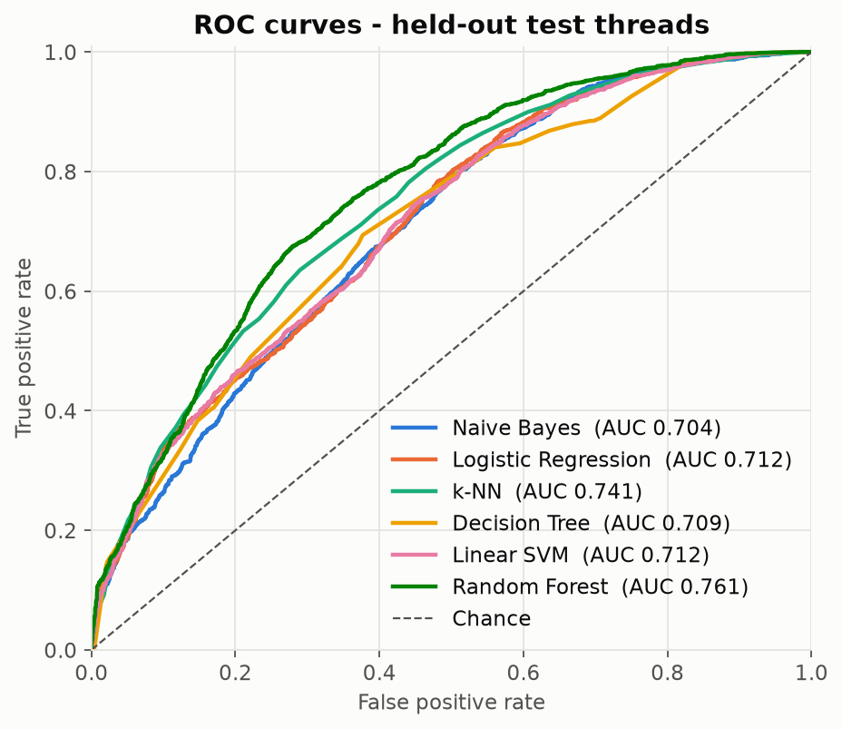
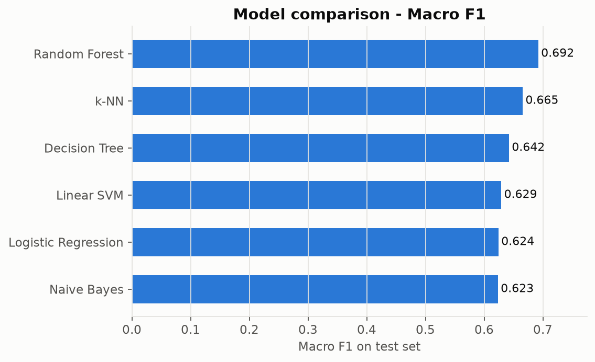
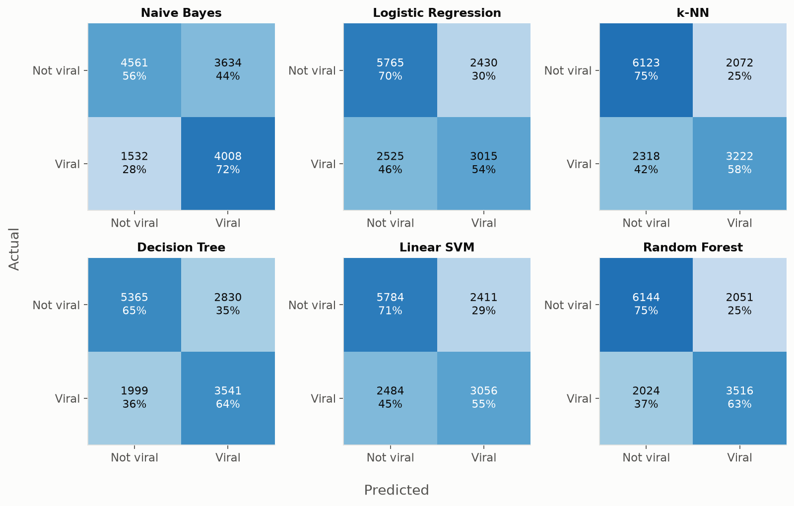
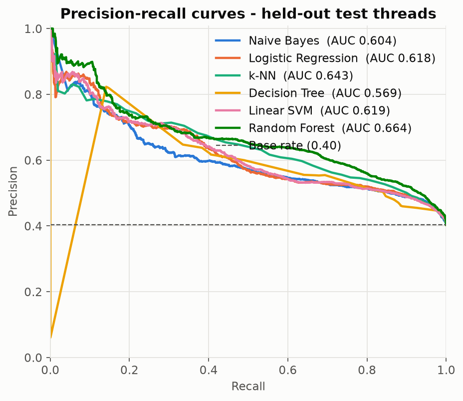
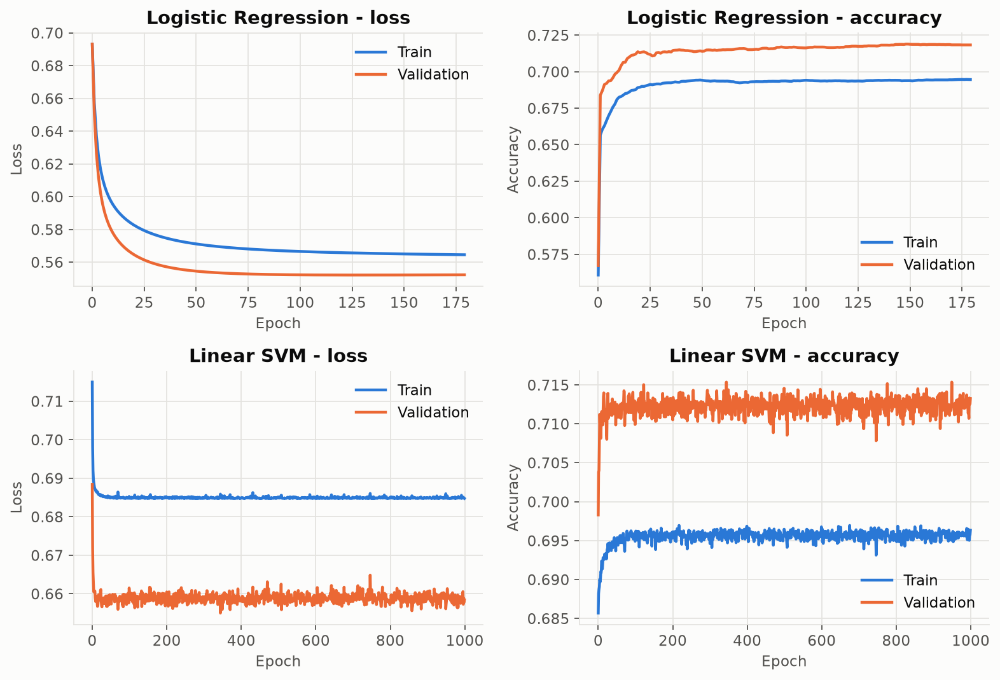
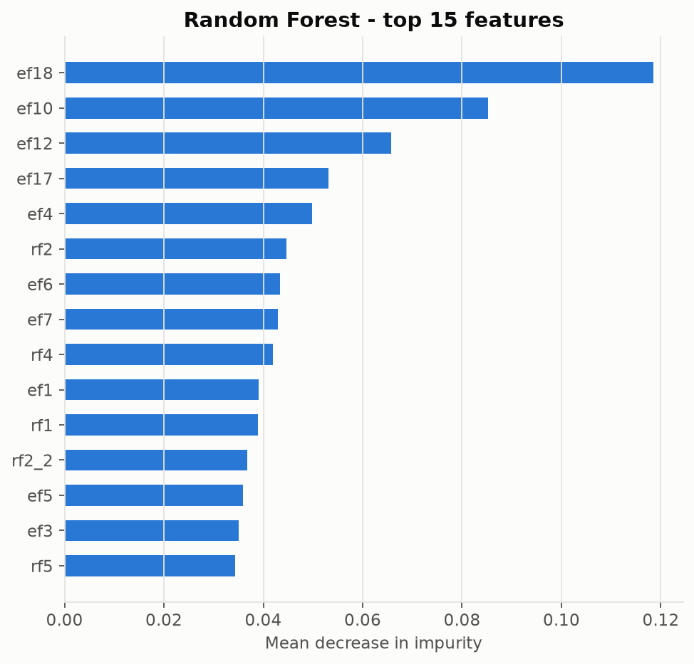

# Viral Thread Classifier

**Predicting which dark web forum threads go viral, using five machine learning models written from scratch in NumPy.**

[](https://www.python.org/)
[](https://numpy.org/)
[](tests/)
[](https://colab.research.google.com/github/melmckune/viral-thread-classifier/blob/main/notebooks/predict_post_virality.ipynb)

Given a thread's root post and its early activity on an underground forum, can we predict whether it will go viral?
This project frames that as binary classification on **72k samples from 1,195 threads**. It implements Gaussian Naive Bayes, softmax Logistic Regression, k-NN, a CART Decision Tree and a Linear SVM **from scratch**, then compares them against a scikit-learn Random Forest.

<p align="center">
  
  
</p>

---

## Highlights

- **Five classifiers built from first principles.** No `sklearn` estimators: closed-form Gaussian likelihoods, gradient descent with softmax and cross-entropy, Gini-based tree induction, and hinge-loss SGD are all written in NumPy.
- **Leakage-aware evaluation.** Each thread appears up to ~200 times under different virality definitions, so the data is split **by thread (`topic_id`)** rather than by row. The scaler is fit on training data only, every hyperparameter is chosen on the validation set, and the test set is used exactly once.
- **Performance engineering.**
  - The decision tree finds the best split for a feature in one sort plus cumulative class counts (O(n log n)) instead of re-partitioning the data for every candidate threshold.
  - k-NN computes distances in vectorized, memory-bounded chunks. It finds neighbors once at the largest *k*, so the whole *k* sweep costs one pass.
  - The full pipeline (6 models, 42 hyperparameter configurations) runs in **under a minute on a laptop**.
- **Verified against references.** Unit tests check that the from-scratch Naive Bayes and k-NN match scikit-learn's predictions and that every model learns a separable problem.
- **Reproducible.** One command downloads the data, another trains every model and regenerates every number and figure in this README.

## Results

All numbers are on the **held-out test threads** (13,735 samples from 239 threads that were never seen during training or tuning).

| Model | Implementation | Accuracy | Macro F1 | ROC AUC | Selected hyperparameters |
|---|---|---:|---:|---:|---|
| Random Forest | scikit-learn (reference) | **0.703** | **0.692** | **0.761** | 25 trees, max depth 15 |
| k-NN | from scratch | 0.680 | 0.665 | 0.741 | k = 50 |
| Decision Tree | from scratch | 0.648 | 0.642 | 0.709 | max depth 5 |
| Linear SVM | from scratch | 0.644 | 0.629 | 0.712 | lr = 0.01, λ = 0.01 |
| Logistic Regression | from scratch | 0.639 | 0.624 | 0.712 | L2, λ = 0 |
| Gaussian Naive Bayes | from scratch | 0.624 | 0.623 | 0.704 | — |

*The majority-class baseline scores 0.597 accuracy on this split.*

### Key takeaways

1. **Nonlinear models win.** Random Forest and k-NN beat every linear model by 3–6 points of macro F1, which suggests the decision boundary between viral and non-viral threads is not linearly separable in this feature space.
2. **The linear models land in nearly the same place.** Logistic regression and the linear SVM reach the same ROC AUC (0.712) with different losses. Regularization had no measurable effect, which is consistent with 43k samples and only 25 features.
3. **Naive Bayes trades precision for recall.** It catches 72% of viral threads, the highest recall of any model, but its false positive rate is far higher. The confusion matrices below show this trade-off.
4. **The `ef*` features carry most of the signal.** All five of the Random Forest's top features, and 10 of its top 15, come from the `ef*` family, led by `ef18`, `ef10` and `ef12`.
5. **There is a generalization gap between thread groups.** Validation accuracy (~0.69–0.75) is consistently higher than test accuracy (~0.62–0.70) for every model. Because the splits are grouped by thread, this reflects real variation between threads, which a row-level split would have hidden.

<details>
<summary><b>More figures</b>: confusion matrices, PR curves, training curves, feature importance</summary>

<br>






</details>

## How it works

```
viral-db.csv ──► group split by topic_id (60/20/20) ──► StandardScaler (fit on train)
                                                                   │
              ┌──────────────┬──────────────┬──────────────┬──────┴───────┬──────────────┐
         Naive Bayes    Logistic Reg.      k-NN       Decision Tree    Linear SVM    Random Forest
                                                                                     (sklearn ref)
              └──────────── hyperparameter search on validation split ─────────────────────┘
                                                   │
                         single evaluation on test split ──► metrics.json, results.md, figures
```

| Model | Implementation notes | File |
|---|---|---|
| Gaussian Naive Bayes | Per-class means and variances, log-space joint likelihood, numerically stable softmax for probabilities | [`naive_bayes.py`](virality/models/naive_bayes.py) |
| Logistic Regression | Softmax and cross-entropy, full-batch gradient descent, L1/L2 penalties, early stopping that restores the best-validation weights | [`logistic_regression.py`](virality/models/logistic_regression.py) |
| k-NN | Expanded squared-distance identity ‖a‖² + ‖b‖² − 2a·b, chunked to bound memory, `argpartition` for top-k | [`knn.py`](virality/models/knn.py) |
| Decision Tree | CART with Gini impurity and a vectorized threshold search via cumulative class counts | [`decision_tree.py`](virality/models/decision_tree.py) |
| Linear SVM | Primal soft-margin hinge loss, mini-batch SGD with subgradients | [`svm.py`](virality/models/svm.py) |

Metrics (per-class precision, recall and F1, macro and weighted F1, confusion matrix) are also implemented by hand in [`metrics.py`](virality/metrics.py).

## Run it yourself

**Requirements:** Python 3.10+

```bash
# 1. Clone and install
git clone https://github.com/melmckune/viral-thread-classifier.git
cd viral-thread-classifier
python -m venv .venv && source .venv/bin/activate      # Windows: .venv\Scripts\activate
pip install -r requirements.txt

# 2. Download the dataset (~60 MB) into data/
python scripts/download_data.py

# 3. Train, tune and evaluate all six models (about 1 minute)
python -m virality.train
```

This prints per-model tuning logs and test metrics, then writes:

- `results/results.md`: the results table
- `results/metrics.json`: every metric, confusion matrix, selected hyperparameters and training time
- `assets/figures/*.png`: all the figures above

**Useful options:**

```bash
python -m virality.train --quick                 # smaller grids, a few seconds
python -m virality.train --models knn tree rf    # just a subset (nb logreg knn tree svm rf)
python -m virality.train --data path/to/viral-db.csv
```

**Run the tests:**

```bash
pytest
```

**Notebook:** The original exploratory notebook, with its outputs, is in [`notebooks/predict_post_virality.ipynb`](notebooks/predict_post_virality.ipynb). Click the **Open in Colab** badge above, then choose *Runtime → Run all*. The notebook downloads the dataset itself and finishes in a few minutes. It also runs in local Jupyter (`jupyter notebook notebooks/`), where it uses `data/viral-db.csv` if you've already downloaded it.

## Project structure

```
viral-thread-classifier/
├── virality/                  # Python package
│   ├── data.py                # loading, grouped split, scaling
│   ├── metrics.py             # from-scratch classification metrics
│   ├── plotting.py            # figure generation
│   ├── train.py               # CLI: tune → evaluate → save results
│   └── models/                # from-scratch NumPy implementations
│       ├── naive_bayes.py
│       ├── logistic_regression.py
│       ├── knn.py
│       ├── decision_tree.py
│       └── svm.py
├── tests/                     # pytest checks (incl. parity with scikit-learn)
├── scripts/download_data.py   # fetches the dataset from Google Drive
├── notebooks/                 # original Colab notebook + exported script
├── results/                   # generated metrics
├── assets/figures/            # generated figures
├── data/                      # dataset goes here (git-ignored)
└── requirements.txt
```

## Dataset

72,244 labelled samples from 1,195 threads across two dark web forums. Each sample has 25 numeric features from the `rf*` and `ef*` families, plus a binary `class_label` (43% viral). See [`data/README.md`](data/README.md) for details.

## Possible extensions

- Gradient-boosted trees (XGBoost or LightGBM) and a from-scratch Random Forest built on the existing `DecisionTree`
- Probability calibration and threshold tuning for a target precision or recall
- Grouped k-fold cross-validation to put confidence intervals on the validation-to-test gap
- Adding the `of*` and `tf*` feature families, which the models don't use yet

## Background

This project started as the final project for **EE 559 (Machine Learning)**. I later refactored it from a single Colab notebook into a tested, reproducible Python package.
